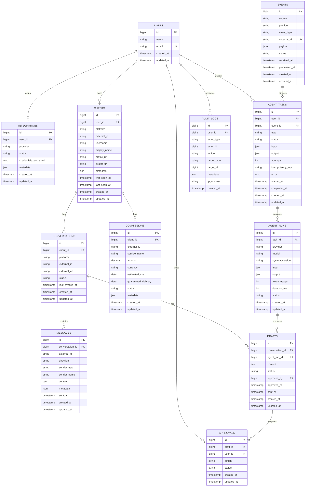

# ClientAgent — Technical Blueprint

> **Status:** Revised Draft
> **Version:** 0.2
> **Project Type:** Personal AI Client Management Agent
> **Primary Platform:** VGen
> **Primary Notification / Control Channel:** Discord
> **Optional Channel:** Telegram
> **Frontend:** SvelteKit + TypeScript
> **Backend:** Elysia + Bun + TypeScript
> **Worker:** Bun + TypeScript
> **Database:** PostgreSQL
> **ORM:** Drizzle ORM
> **Queue / Event Processing:** Redis Streams + Bun workers
> **AI:** LLM API + tool calling
> **Browser Automation:** Playwright
> **Email Integration:** Gmail API + Google Cloud Pub/Sub
> **Package Management / Runtime:** Bun
> **Repository:** Bun workspaces monorepo
>
> This revision intentionally replaces the previous Laravel + Next.js architecture with a full TypeScript + Bun architecture.

---

# 1. Product Overview

ClientAgent is a personal AI agent designed to help a creator monitor and manage client communication on platforms such as VGen.

The system treats VGen notification emails primarily as **event triggers**, not as the authoritative source of conversation content. The actual conversation is retrieved from VGen when necessary through an appropriate integration mechanism.

The core workflow is:

```text
VGen
  │
  │ notification email
  ▼
Gmail
  │
  │ Gmail API / Pub/Sub
  ▼
Elysia API
  │
  ├── Event ingestion
  ├── Database
  ├── Agent orchestration
  └── Queue
          │
          ▼
      Bun Worker
          │
          ├── AI
          ├── Playwright
          └── Discord
```

Default behavior is human-in-the-loop:

```text
DETECT
  ↓
READ
  ↓
UNDERSTAND
  ↓
DRAFT
  ↓
HUMAN APPROVAL
  ↓
EXECUTE
```

The agent assists the creator; it should not silently impersonate the creator.

---

# 2. Why Full TypeScript + Bun

The project is primarily an orchestration and automation system rather than a machine-learning system.

Its major workloads are:

- API requests
- event processing
- background jobs
- browser automation
- Gmail API
- Discord API
- LLM API / tool calling
- PostgreSQL
- Redis
- web dashboard

These workloads do not require Python-specific ML libraries.

Therefore the project will use one language across the stack:

```text
TypeScript
   │
   ├── SvelteKit
   ├── Elysia
   ├── Bun Workers
   ├── Playwright
   ├── Discord integration
   ├── Gmail integration
   ├── AI SDK
   └── Shared domain types
```

Benefits:

- shared types between frontend and backend
- one runtime ecosystem
- simpler repository structure
- easier refactoring
- easier AI/tool integration
- easier Playwright integration
- less context switching between TypeScript and Python

FastAPI remains a valid alternative if the project later develops significant Python-specific ML/data-processing requirements. It is not required for the current architecture.

---

# 3. Goals

## 3.1 Primary Goals

- Detect VGen-related email notifications.
- Identify the client and event type.
- Notify the creator through Discord.
- Retrieve the relevant VGen conversation when requested.
- Store normalized conversation data.
- Summarize conversations with AI.
- Generate response drafts.
- Accept natural-language instructions from the creator.
- Allow editing, approval, and rejection of drafts.
- Send approved messages through VGen when technically and contractually permitted.
- Maintain client and commission context.
- Keep every important agent action observable.

## 3.2 Secondary Goals

- Web dashboard.
- Telegram support.
- Client memory.
- Commission lifecycle tracking.
- Multiple platform adapters.
- Metrics and operational monitoring.
- Evaluation of AI draft quality.

---

# 4. Non-Goals

The initial system will not:

- automatically reply to every client without approval;
- store the VGen password;
- bypass CAPTCHA;
- bypass 2FA;
- bypass anti-bot mechanisms;
- circumvent rate limits or platform security controls;
- perform mass scraping;
- perform autonomous financial transactions;
- modify important commissions without user approval;
- hide agent activity from the account owner;
- claim that the AI is a human operator.

Browser automation should only be used where appropriate and when no suitable official API is available.

---

# 5. Product Principles

## 5.1 Human Control

The creator remains responsible for external communication.

## 5.2 Read Before Write

```text
READ
 ↓
ANALYZE
 ↓
DRAFT
 ↓
APPROVE
 ↓
WRITE
```

## 5.3 Observable Actions

Important actions must be traceable:

```text
Agent read conversation
Agent generated draft
User edited draft
User approved draft
Agent attempted send
Message sent
```

## 5.4 Provider-Agnostic Core

The agent should not directly depend on VGen-specific implementation details.

```text
Agent Core
   │
   ├── Platform Adapter
   ├── Email Adapter
   ├── Notification Adapter
   └── AI Provider
```

## 5.5 Queue-First Architecture

Long-running operations should not execute inside HTTP requests.

```text
HTTP request
   ↓
Create task
   ↓
Queue
   ↓
Worker
   ↓
Result
```

This is especially important for Playwright and AI operations.

---

# 6. Final Technology Stack

| Layer | Technology |
|---|---|
| Runtime | Bun |
| Language | TypeScript |
| Frontend | SvelteKit |
| Backend | Elysia |
| Worker | Bun |
| Database | PostgreSQL |
| ORM | Drizzle ORM |
| Database Driver | postgres.js |
| Queue/Event Processing | Redis Streams |
| Browser Automation | Playwright |
| AI | LLM API + tool calling |
| Email | Gmail API |
| Email Events | Google Cloud Pub/Sub |
| Notifications | Discord Bot |
| Optional Notifications | Telegram Bot |
| Validation | Elysia TypeBox / schema validation |
| Testing | Bun test + Playwright tests |
| Containerization | Docker |
| Package Management | Bun workspaces |

---

# 7. High-Level Architecture

```text
                               ┌───────────────┐
                               │     VGen      │
                               └───────┬───────┘
                                       │
                              notification email
                                       │
                                       ▼
                               ┌───────────────┐
                               │     Gmail     │
                               └───────┬───────┘
                                       │
                                  Gmail API
                                       │
                                       ▼
                              Google Cloud Pub/Sub
                                       │
                                       ▼
                              ┌──────────────────┐
                              │   Elysia API     │
                              │      Bun         │
                              └────────┬─────────┘
                                       │
                    ┌──────────────────┼──────────────────┐
                    │                  │                  │
                    ▼                  ▼                  ▼
               PostgreSQL           Redis          Agent Orchestrator
                    │                  │                  │
                    │                  │                  │
                    │                  ▼                  │
                    │            Bun Workers             │
                    │                  │                  │
                    │       ┌──────────┼───────────┐      │
                    │       │          │           │      │
                    │       ▼          ▼           ▼      │
                    │   Playwright    LLM       Discord   │
                    │       │                      │      │
                    │       ▼                      ▼      │
                    │      VGen                 Creator   │
                    │
                    └──────────────► SvelteKit ◄──────────┘
```

---

# 8. Repository Architecture

Use a Bun workspaces monorepo.

```text
client-agent/
│
├── apps/
│   ├── web/                    # SvelteKit frontend
│   ├── api/                    # Elysia HTTP API
│   └── worker/                 # Bun background workers
│
├── packages/
│   ├── db/                     # Drizzle schema + repositories
│   ├── domain/                 # Domain entities and contracts
│   ├── agent/                  # Agent orchestration + tools
│   ├── ai/                     # LLM provider abstraction
│   ├── platform/               # PlatformAdapter contracts
│   ├── vgen/                   # VGen adapter
│   ├── gmail/                  # Gmail adapter
│   ├── discord/                # Discord adapter
│   ├── telegram/               # Telegram adapter
│   ├── browser/                # Playwright utilities
│   ├── queue/                  # Redis Streams abstraction
│   ├── config/                 # Environment/config handling
│   └── shared/                 # Shared schemas/types/utilities
│
├── infrastructure/
│   ├── docker/
│   ├── postgres/
│   └── redis/
│
├── docs/
│   ├── PRD.md
│   ├── ARCHITECTURE.md
│   ├── ERD.md
│   ├── API.md
│   ├── AGENT_TOOLS.md
│   └── ADR/
│
├── tests/
│   ├── integration/
│   └── e2e/
│
├── package.json
├── bun.lock
├── tsconfig.json
└── README.md
```

The goal is not to create dozens of packages immediately. Packages should be extracted when a clear boundary exists.

---

# 9. Application Responsibilities

## 9.1 SvelteKit

Responsibilities:

- dashboard UI;
- client management UI;
- conversation viewer;
- commission viewer;
- draft editor;
- approval UI;
- integration settings;
- agent task status;
- audit log viewer.

SvelteKit should not contain business logic that belongs to the Elysia domain layer.

## 9.2 Elysia API

Responsibilities:

- authentication/session handling;
- REST/API endpoints;
- request validation;
- authorization;
- webhook ingestion;
- task creation;
- database queries through domain/repository layers;
- queue publishing;
- approval operations;
- dashboard data APIs.

## 9.3 Bun Worker

Responsibilities:

- consume Redis Streams;
- process background tasks;
- run Playwright;
- call AI tools;
- send Discord notifications;
- synchronize conversations;
- execute approved external writes;
- record task execution and failures.

Workers should be independently restartable.

---

# 10. Queue Architecture

Redis is used for asynchronous work.

Instead of putting long-running operations directly into Elysia requests:

```text
Elysia
  ↓
Redis Stream
  ↓
Worker Consumer
  ↓
Task Handler
```

Suggested streams:

```text
client-agent:events
client-agent:notifications
client-agent:agent
client-agent:browser
client-agent:send
client-agent:sync
```

Suggested tasks:

```text
PROCESS_GMAIL_EVENT
NOTIFY_DISCORD
READ_VGEN_CONVERSATION
SYNC_CONVERSATION
GENERATE_SUMMARY
GENERATE_REPLY_DRAFT
SEND_VGEN_MESSAGE
SYNC_COMMISSION
```

Each task should have:

- task ID;
- type;
- payload;
- status;
- attempts;
- timestamps;
- error information;
- idempotency key.

---

# 11. Event Pipeline

```text
RECEIVED
   ↓
VALIDATED
   ↓
PARSED
   ↓
NORMALIZED
   ↓
PERSISTED
   ↓
QUEUED
   ↓
PROCESSED
```

Every external event must have an idempotency strategy.

If the same Gmail notification is observed twice:

```text
Event A
Event A
```

the system must not produce duplicate external actions.

---

# 12. Gmail Integration

## 12.1 Preferred Architecture

```text
Gmail
  ↓
Gmail API
  ↓
Google Cloud Pub/Sub
  ↓
Elysia webhook
  ↓
Redis
  ↓
Bun worker
```

The Gmail push event should be treated as a mailbox-change signal. The backend then uses Gmail API to retrieve the relevant message/history data.

## 12.2 Processing Flow

```text
Gmail mailbox change
       ↓
Pub/Sub notification
       ↓
POST /api/v1/webhooks/google/gmail
       ↓
Validate notification
       ↓
Fetch Gmail history/message
       ↓
Find VGen email
       ↓
Parse event
       ↓
Store event
       ↓
Publish task
```

## 12.3 Apps Script

Google Apps Script may be used for an early prototype if it accelerates experimentation.

It is not the target architecture.

Target:

```text
Gmail API + Pub/Sub
```

---

# 13. VGen Email Event Parser

Initial event categories:

```text
NEW_MESSAGE
NEW_COMMISSION
COMMISSION_CONFIRMED
COMMISSION_UPDATED
COMMISSION_COMPLETED
```

Example normalized event:

```json
{
  "source": "gmail",
  "provider": "vgen",
  "eventType": "NEW_MESSAGE",
  "externalId": "gmail-message-id",
  "clientUsername": "ErianOsamu",
  "subject": "@ErianOsamu sent you a new message!",
  "receivedAt": "2026-09-10T23:10:00Z"
}
```

The parser should tolerate minor email-format changes.

Do not assume that a VGen email contains the actual conversation body.

---

# 14. Platform Adapter Architecture

The core agent should communicate through interfaces rather than directly with VGen.

```ts
interface PlatformAdapter {
  findClient(input: FindClientInput): Promise<ClientResult>
  getConversation(input: GetConversationInput): Promise<ConversationResult>
  getMessages(input: GetMessagesInput): Promise<MessageResult>
  getCommission(input: GetCommissionInput): Promise<CommissionResult>
  sendMessage(input: SendMessageInput): Promise<SendMessageResult>
}
```

Implementation:

```text
PlatformAdapter
      │
      ├── VGenBrowserAdapter
      └── VGenApiAdapter (future, if appropriate)
```

The Agent Core must not need to change when the platform adapter changes.

---

# 15. VGen Browser Automation

Browser automation is a fallback integration mechanism when an appropriate official API is unavailable.

```text
Agent Tool
    ↓
Platform Adapter
    ↓
VGen Browser Adapter
    ↓
Playwright
    ↓
Authenticated Browser Session
    ↓
VGen
```

## 15.1 Authentication Model

Do not store the VGen password.

Preferred model:

```text
User manually authenticates
        ↓
Dedicated browser profile/session
        ↓
Worker reuses session
```

If the session expires:

```text
Worker
  ↓
Session expired
  ↓
Task paused
  ↓
Notify creator
  ↓
Creator re-authenticates
  ↓
Task may resume
```

The system must not bypass CAPTCHA, 2FA, anti-bot mechanisms, security controls, or rate limits.

---

# 16. AI Agent Architecture

The AI agent is an orchestration layer over explicit tools.

```text
                    User Instruction
                           │
                           ▼
                    ┌─────────────┐
                    │ Agent Core  │
                    └──────┬──────┘
                           │
          ┌────────────────┼────────────────┐
          │                │                │
          ▼                ▼                ▼
     Client Tools   Conversation Tools  Platform Tools
          │                │                │
          └────────────────┼────────────────┘
                           ▼
                     Tool Results
                           │
                           ▼
                       LLM Output
```

The agent should never directly manipulate database tables.

It should call domain tools/services.

---

# 17. Agent Tools

Initial tools:

```text
find_client
get_client
get_conversation
read_vgen_conversation
summarize_conversation
draft_reply
update_draft
request_approval
send_vgen_message
```

## 17.1 Read Tools

Read tools can generally be executed without approval:

```text
find_client
get_client
get_conversation
read_vgen_conversation
summarize_conversation
```

## 17.2 Write Tools

Write tools require stronger authorization:

```text
draft_reply
update_draft
send_vgen_message
```

`send_vgen_message` must require an approved draft.

---

# 18. Example Tool Contract

```ts
export const readVgenConversation = tool({
  description: 'Read the current VGen conversation for a known client.',
  inputSchema: z.object({
    clientUsername: z.string(),
    limit: z.number().int().min(1).max(100).default(20),
  }),
  execute: async ({ clientUsername, limit }) => {
    return vgenAdapter.getConversation({
      username: clientUsername,
      limit,
    })
  },
})
```

The exact AI SDK/provider can remain replaceable.

---

# 19. Client Model

```text
clients
├── id
├── user_id
├── platform
├── external_id
├── username
├── display_name
├── profile_url
├── avatar_url
├── metadata
├── first_seen_at
├── last_seen_at
├── created_at
└── updated_at
```

Suggested uniqueness:

```text
UNIQUE(user_id, platform, username)
```

---

# 20. Conversation Model

```text
conversations
├── id
├── client_id
├── platform
├── external_id
├── external_url
├── status
├── last_synced_at
├── created_at
└── updated_at
```

Suggested uniqueness:

```text
UNIQUE(platform, external_id)
```

---

# 21. Message Model

```text
messages
├── id
├── conversation_id
├── external_id
├── direction
├── sender_type
├── sender_name
├── content
├── metadata
├── sent_at
├── created_at
└── updated_at
```

Directions:

```text
INBOUND
OUTBOUND
```

Suggested uniqueness:

```text
UNIQUE(conversation_id, external_id)
```

---

# 22. Commission Model

```text
commissions
├── id
├── client_id
├── external_id
├── service_name
├── amount
├── currency
├── estimated_start
├── guaranteed_delivery
├── status
├── metadata
├── created_at
└── updated_at
```

Suggested statuses:

```text
REQUESTED
ACCEPTED
PAID
IN_PROGRESS
DELIVERED
COMPLETED
CANCELLED
```

---

# 23. Event Model

```text
events
├── id
├── source
├── provider
├── event_type
├── external_id
├── payload
├── status
├── received_at
├── processed_at
├── created_at
└── updated_at
```

Constraint:

```text
UNIQUE(external_id)
```

The external ID should be chosen so it represents the provider event/message reliably enough for idempotency.

---

# 24. Agent Task Model

```text
agent_tasks
├── id
├── user_id
├── event_id
├── type
├── status
├── input
├── output
├── attempts
├── idempotency_key
├── error
├── started_at
├── completed_at
├── created_at
└── updated_at
```

Example:

```json
{
  "type": "READ_VGEN_CONVERSATION",
  "status": "QUEUED",
  "input": {
    "username": "ErianOsamu"
  }
}
```

---

# 25. Agent Run Model

Every significant AI execution should be recorded.

```text
agent_runs
├── id
├── task_id
├── provider
├── model
├── system_version
├── input
├── output
├── token_usage
├── duration_ms
├── status
├── created_at
└── updated_at
```

This enables:

- debugging;
- evaluation;
- prompt comparison;
- model comparison;
- cost tracking;
- failure analysis.

---

# 26. Draft Model

```text
drafts
├── id
├── conversation_id
├── agent_run_id
├── content
├── status
├── approved_by
├── approved_at
├── sent_at
├── created_at
└── updated_at
```

Statuses:

```text
DRAFT
PENDING_APPROVAL
APPROVED
REJECTED
SENT
FAILED
EXPIRED
```

---

# 27. Approval Model

```text
approvals
├── id
├── draft_id
├── user_id
├── action
├── status
├── created_at
└── updated_at
```

Every external write should be traceable to an explicit approval.

---

# 28. Audit Log Model

```text
audit_logs
├── id
├── user_id
├── actor_type
├── actor_id
├── action
├── target_type
├── target_id
├── metadata
├── ip_address
└── created_at
```

Example actions:

```text
USER_APPROVED_DRAFT
USER_REJECTED_DRAFT
AGENT_READ_CONVERSATION
AGENT_GENERATED_DRAFT
AGENT_ATTEMPTED_SEND
MESSAGE_SENT
MESSAGE_SEND_FAILED
```

---

# 29. Database ERD



---

# 30. API Specification

Base URL:

```text
/api/v1
```

## Authentication

```http
POST /auth/login
POST /auth/logout
GET  /auth/me
```

## Clients

```http
GET    /clients
GET    /clients/:id
POST   /clients
PATCH  /clients/:id
DELETE /clients/:id
```

## Conversations

```http
GET  /clients/:clientId/conversations
GET  /conversations/:id
POST /conversations/:id/sync
GET  /conversations/:id/messages
```

## Commissions

```http
GET   /commissions
GET   /commissions/:id
POST  /commissions/:id/sync
PATCH /commissions/:id
```

## Agent

```http
POST /agent/run
GET  /agent/tasks/:id
GET  /agent/runs/:id
```

## Drafts

```http
GET   /drafts
GET   /drafts/:id
POST  /drafts
PATCH /drafts/:id
POST  /drafts/:id/approve
POST  /drafts/:id/reject
POST  /drafts/:id/send
```

## Integrations

```http
GET    /integrations
POST   /integrations/gmail
DELETE /integrations/gmail
POST   /integrations/discord
DELETE /integrations/discord
POST   /integrations/telegram
DELETE /integrations/telegram
```

## Webhooks

```http
POST /webhooks/google/gmail
POST /webhooks/discord
POST /webhooks/telegram
```

---

# 31. Agent Request Example

```http
POST /api/v1/agent/run
Content-Type: application/json
```

```json
{
  "message": "Read ErianOsamu's latest VGen conversation and tell me what they need."
}
```

Response:

```json
{
  "taskId": "task_123",
  "status": "QUEUED"
}
```

The API returns quickly. The actual agent execution occurs in a worker.

---

# 32. Agent Execution Flow

```text
User
  │
  │ instruction
  ▼
Discord / SvelteKit
  │
  ▼
Elysia API
  │
  ▼
Create Agent Task
  │
  ▼
Redis Stream
  │
  ▼
Bun Worker
  │
  ├── find_client()
  ├── get_conversation()
  ├── read_vgen_conversation()
  └── summarize_conversation()
           │
           ▼
       PostgreSQL
           │
           ▼
       Discord / UI
```

---

# 33. New Message Notification Flow

```text
VGen
 ↓
Notification Email
 ↓
Gmail
 ↓
Pub/Sub
 ↓
Elysia webhook
 ↓
Event parser
 ↓
PostgreSQL event
 ↓
Redis Stream
 ↓
Bun Worker
 ↓
Discord notification
```

Example Discord message:

```text
🔔 New VGen Message

Client: ErianOsamu
Event: New Message

The notification email does not contain the conversation content.

[Read Conversation]
```

---

# 34. Reply Flow

```text
User instruction
      ↓
Agent
      ↓
Read conversation
      ↓
Generate draft
      ↓
Save draft
      ↓
Pending approval
      ↓
User approves/edits/rejects
```

Example:

```text
🤖 Draft

Hi Erian! Thanks for reaching out.
I'm available for the project.
Could you let me know your deadline?

[Approve] [Edit] [Reject]
```

---

# 35. Send Flow

```text
User approves
      ↓
Elysia validates approval
      ↓
Validate draft version
      ↓
Create SEND_VGEN_MESSAGE task
      ↓
Redis Stream
      ↓
Bun browser worker
      ↓
Open authenticated VGen session
      ↓
Find conversation
      ↓
Verify target client
      ↓
Verify draft
      ↓
Send message
      ↓
Verify result
      ↓
Persist outbound message
      ↓
Audit log
      ↓
Notify Discord / UI
```

---

# 36. Safety Gate Before Sending

Before a write operation:

```text
1. Is the target conversation correct?
2. Is the target client correct?
3. Is the authenticated account correct?
4. Is the draft approved?
5. Has the draft changed since approval?
6. Is the approval still valid?
7. Is the action still valid in the current conversation state?
```

If any check fails:

```text
DO NOT SEND
```

---

# 37. Retry Strategy

Non-destructive operations can use bounded retries:

```text
attempt 1 → immediate
attempt 2 → short delay
attempt 3 → longer delay
attempt 4 → longer delay
attempt 5 → failed/dead-letter state
```

Write operations require special handling.

Never blindly retry a message send after an ambiguous network failure.

```text
Send message
   ↓
Network timeout
   ↓
DO NOT immediately send again
   ↓
Inspect conversation / verify result
   ↓
Determine whether message already exists
```

---

# 38. AI Memory

## 38.1 Short-Term Context

```text
recent messages
current instruction
current draft
current task
```

## 38.2 Long-Term Client Context

```text
communication language
known preferences
previous commission history
important project information
creator notes
```

Memory must distinguish:

```text
FACT
PREFERENCE
INFERENCE
```

The agent must not present an inference as a known fact.

---

# 39. Prompt Architecture

```text
Base Agent Rules
      ↓
Tool Rules
      ↓
Safety Rules
      ↓
Creator Preferences
      ↓
Client Context
      ↓
Conversation Context
      ↓
Current User Instruction
```

Example:

```text
BASE:
You are a client communication assistant.

SAFETY:
Never send an external message without explicit approval.

CREATOR:
The creator prefers concise, friendly communication.

CLIENT:
Client prefers English.

CONVERSATION:
[recent messages]

USER:
Ask about their deadline.
```

---

# 40. Agent Confidence

The agent should classify uncertainty:

```text
HIGH_CONFIDENCE
MEDIUM_CONFIDENCE
LOW_CONFIDENCE
```

If confidence is low:

```text
I am not confident which conversation
or interpretation is correct.

Please clarify:
...
```

The agent should not guess when the target client, conversation, or intended action is ambiguous.

---

# 41. Frontend — SvelteKit Dashboard

SvelteKit is the selected frontend instead of Next.js.

Pages:

```text
/
/dashboard
/clients
/clients/:id
/conversations
/conversations/:id
/commissions
/drafts
/approvals
/agent
/integrations
/settings
/audit-log
```

Dashboard overview:

```text
┌──────────────────────────────────────┐
│ ClientAgent                          │
├──────────────────────────────────────┤
│ New Messages       3                 │
│ Pending Replies    2                 │
│ Active Commissions 4                 │
│ Upcoming Deadlines 2                 │
├──────────────────────────────────────┤
│ Recent Activity                      │
│                                      │
│ ErianOsamu → New Message             │
│ John → Reply Awaiting Approval       │
│ Alice → Commission Confirmed         │
└──────────────────────────────────────┘
```

## Frontend priorities

MVP does not require the complete dashboard.

Priority:

```text
1. Dashboard shell
2. Agent task status
3. Conversation viewer
4. Draft viewer/editor
5. Approval UI
6. Clients
7. Commissions
8. Integrations
9. Audit log
```

---

# 42. Discord Integration

Discord is the primary control channel for MVP.

Suggested commands:

```text
/help
/status
/clients
/client <username>
/read <username>
/summarize <username>
/reply <username>
/approve <draft>
/reject <draft>
```

Discord should call the same Agent Core used by the web dashboard.

```text
Discord ──────┐
              │
SvelteKit ────┼──► Elysia / Agent Core
              │
Telegram ─────┘
```

No duplicated agent logic.

---

# 43. Security

## 43.1 Credentials

OAuth credentials/tokens must be encrypted at rest where applicable.

Never log:

```text
access_token
refresh_token
session_cookie
password
bot_token
```

## 43.2 Browser Session

Use a dedicated authenticated browser profile.

Do not expose the profile directory publicly.

## 43.3 Webhook Security

Verify:

- provider authenticity/signature where available;
- Pub/Sub authenticity;
- replay protection;
- idempotency.

## 43.4 Authorization

Every resource must belong to the authenticated user.

---

# 44. Privacy

Conversation data is private client data.

The system should:

- minimize stored content;
- provide deletion mechanisms;
- restrict access to the owner;
- avoid unnecessary message content in logs;
- encrypt sensitive integration credentials;
- avoid sending client information to unnecessary external services.

---

# 45. Observability

Track at minimum:

```text
events_received
events_processed
events_failed
queue_tasks_created
queue_tasks_completed
queue_tasks_failed
browser_tasks_completed
browser_tasks_failed
drafts_created
drafts_approved
drafts_rejected
messages_sent
messages_failed
```

AI metrics:

```text
latency
token_usage
tool_calls
failure_rate
approval_rate
edit_rate
```

Worker metrics:

```text
queue_depth
processing_latency
retry_count
dead_letter_count
```

---

# 46. Testing Strategy

## Unit Tests

Use Bun test for:

- event parser;
- domain services;
- schemas;
- authorization rules;
- idempotency logic;
- draft state transitions.

## Integration Tests

Test:

```text
Gmail event
 → parser
 → database
 → queue
```

and:

```text
agent task
 → tool
 → adapter
 → database
```

## Browser Tests

Playwright tests should validate the VGen adapter against a controlled test/staging setup where available.

Do not design tests around bypassing platform security mechanisms.

## End-to-End Tests

Critical path:

```text
New event
 → Discord notification
 → read conversation
 → AI summary
 → draft
 → approval
 → send
 → audit log
```

---

# 47. MVP Scope

## MVP-1 — Event Pipeline

No AI and no browser automation.

```text
VGen
 ↓
Gmail
 ↓
Gmail API
 ↓
Pub/Sub
 ↓
Elysia
 ↓
PostgreSQL
 ↓
Redis
 ↓
Bun Worker
 ↓
Discord
```

Success:

> A VGen notification email produces exactly one corresponding Discord notification.

## MVP-2 — Conversation Reader

```text
Discord
 ↓
/read username
 ↓
Elysia
 ↓
Redis
 ↓
Bun Worker
 ↓
Playwright
 ↓
VGen
 ↓
Conversation
 ↓
Discord
```

Success:

> The system can retrieve the correct conversation for a known client.

## MVP-3 — AI Summary

```text
Conversation
 ↓
Agent
 ↓
LLM
 ↓
Summary
 ↓
Discord / SvelteKit
```

## MVP-4 — Draft Reply

```text
User instruction
 ↓
Agent
 ↓
Conversation context
 ↓
LLM
 ↓
Draft
```

## MVP-5 — Human Approval

```text
Draft
 ↓
PENDING_APPROVAL
 ↓
Approve / Edit / Reject
```

## MVP-6 — VGen Send

```text
Approved draft
 ↓
Send task
 ↓
Playwright
 ↓
VGen
 ↓
Verify
 ↓
Audit
```

## MVP-7 — SvelteKit Dashboard

Build the dashboard after the event/agent core is stable.

---

# 48. Development Roadmap

```text
Phase 0 — Foundation
│
├── Bun monorepo
├── TypeScript config
├── Elysia
├── SvelteKit
├── PostgreSQL
├── Drizzle
└── Redis

Phase 1 — Event Pipeline
│
├── Gmail OAuth
├── Gmail API
├── Pub/Sub
├── webhook
├── parser
├── event store
└── Discord notification

Phase 2 — Worker System
│
├── Redis Streams
├── consumer
├── task state
├── retries
└── idempotency

Phase 3 — VGen Reader
│
├── Playwright
├── browser profile
├── VGen adapter
├── client finder
└── conversation reader

Phase 4 — AI Agent
│
├── agent core
├── tool registry
├── context builder
├── summary
└── draft generation

Phase 5 — Approval
│
├── draft state machine
├── approval records
├── edit flow
└── Discord approval UI

Phase 6 — VGen Write
│
├── send task
├── target verification
├── send verification
└── audit log

Phase 7 — Dashboard
│
├── SvelteKit UI
├── conversations
├── drafts
├── approvals
├── clients
└── integrations

Phase 8 — Memory
│
├── client facts
├── preferences
├── commission history
└── memory evaluation

Phase 9 — Multi-platform
│
├── Telegram
└── additional platform adapters
```

---

# 49. First Milestone

The first milestone deliberately contains **zero AI** and **zero VGen browser automation**.

Build only:

```text
VGen
 ↓
Email
 ↓
Gmail API
 ↓
Pub/Sub
 ↓
Elysia webhook
 ↓
Event parser
 ↓
PostgreSQL
 ↓
Redis Stream
 ↓
Bun Worker
 ↓
Discord
```

Expected result:

```text
Client sends VGen message
        ↓
VGen sends notification email
        ↓
Gmail receives email
        ↓
Pub/Sub signals mailbox change
        ↓
Elysia receives event
        ↓
Backend recognizes VGen event
        ↓
Event stored
        ↓
Worker processes notification
        ↓
Discord notification
```

Only after this is reliable should browser automation and AI be added.

---

# 50. Architecture Decision Records

## ADR-001 — Full TypeScript

**Decision:** Use TypeScript across frontend, backend, workers, integrations, and agent tooling.

**Reason:** The project is primarily an orchestration/automation system and does not currently require Python-specific ML infrastructure.

## ADR-002 — Bun Runtime

**Decision:** Use Bun as the runtime and package manager.

**Reason:** One fast TypeScript runtime across API and worker applications.

## ADR-003 — SvelteKit Frontend

**Decision:** Use SvelteKit instead of Next.js.

**Reason:** The user wants a TypeScript-first stack and prefers SvelteKit for the dashboard.

## ADR-004 — Elysia Backend

**Decision:** Use Elysia on Bun.

**Reason:** Strong fit for a lightweight typed API layer in the same TypeScript runtime as the worker and frontend ecosystem.

## ADR-005 — Queue-First Backend

**Decision:** Long-running operations execute through Bun workers rather than HTTP requests.

**Reason:** Playwright, LLM calls, synchronization, and external APIs can be slow or failure-prone.

## ADR-006 — Redis Streams

**Decision:** Use Redis Streams as the initial queue/event-processing mechanism.

**Reason:** It provides an explicit event/consumer model while keeping the infrastructure simple. A dedicated queue library can be introduced later if operational needs justify it.

## ADR-007 — Gmail API + Pub/Sub

**Decision:** Use Gmail API + Pub/Sub for the production email event architecture.

**Reason:** It fits the event-driven backend architecture. Apps Script remains acceptable for a prototype.

## ADR-008 — Browser Automation for VGen

**Decision:** Use a VGen browser adapter only when an appropriate official API is unavailable.

**Reason:** Notification emails do not necessarily contain the actual conversation content.

**Constraint:** Never bypass platform security or anti-bot mechanisms.

## ADR-009 — Human Approval

**Decision:** All external write operations require approval by default.

**Reason:** Prevent unintended communication and maintain creator control.

## ADR-010 — Platform Adapters

**Decision:** Isolate VGen-specific logic behind a PlatformAdapter.

**Reason:** Future platforms or an official API can be added without rewriting the agent core.

---

# 51. Success Metrics

Initial targets:

```text
Notification detection       >= 95%
Duplicate processing         = 0
Unapproved external sends    = 0
Correct conversation match   >= 95%
Successful browser reads     >= 90%
Successful approved sends    >= 95%
```

AI quality can initially be evaluated manually:

```text
Draft accepted without edit
Draft accepted after edit
Draft rejected
```

Additional metrics:

```text
Average task latency
Average AI cost per task
Browser failure rate
Queue failure rate
Approval rate
Edit rate
```

---

# 52. Production Deployment Concept

Initial deployment can be split into three application processes:

```text
                    ┌───────────────┐
                    │    SvelteKit  │
                    └───────┬───────┘
                            │
                            ▼
                    ┌───────────────┐
                    │  Elysia API   │
                    └───────┬───────┘
                            │
                ┌───────────┼───────────┐
                ▼           ▼           ▼
           PostgreSQL     Redis      Bun Worker
                                      │
                                      ▼
                                  Playwright
```

Each service can be containerized independently.

For local development:

```text
docker compose
├── postgres
└── redis

bun dev
├── web
├── api
└── worker
```

---

# 53. Environment Variables

Example categories:

```text
# Application
NODE_ENV
APP_URL

# Database
DATABASE_URL

# Redis
REDIS_URL

# Gmail / Google
GOOGLE_CLIENT_ID
GOOGLE_CLIENT_SECRET
GOOGLE_REDIRECT_URI
GOOGLE_PUBSUB_TOPIC
GOOGLE_PUBSUB_AUDIENCE

# Discord
DISCORD_BOT_TOKEN
DISCORD_APPLICATION_ID
DISCORD_GUILD_ID

# AI
AI_PROVIDER_API_KEY
AI_MODEL

# Browser
BROWSER_PROFILE_PATH

# Authentication
AUTH_SECRET
```

Never commit real secrets to the repository.

---

# 54. Recommended Implementation Order

Do not start with the autonomous agent.

```text
1. Bun workspace
        ↓
2. Elysia API
        ↓
3. PostgreSQL + Drizzle
        ↓
4. Redis + worker
        ↓
5. Gmail integration
        ↓
6. VGen email parser
        ↓
7. Discord notification
        ↓
8. Event/idempotency tests
        ↓
9. Playwright VGen reader
        ↓
10. Conversation storage
        ↓
11. AI summary
        ↓
12. AI draft
        ↓
13. Approval system
        ↓
14. Approved VGen send
        ↓
15. SvelteKit dashboard
        ↓
16. Client memory
        ↓
17. Telegram / additional platforms
```

---

# 55. Definition of Done

## Notification

- [ ] Gmail integration works.
- [ ] VGen emails are recognized.
- [ ] Duplicate events are ignored.
- [ ] Event is persisted.
- [ ] Queue task is created.
- [ ] Discord notification is delivered.

## Worker

- [ ] Worker consumes Redis Streams.
- [ ] Tasks have states.
- [ ] Failed tasks can retry.
- [ ] Tasks become permanently failed after bounded retries.
- [ ] Idempotency prevents duplicate work.

## Conversation

- [ ] Known client can be located.
- [ ] Correct conversation can be opened.
- [ ] Recent messages can be extracted.
- [ ] Conversation can be stored.
- [ ] Browser session expiration is handled.

## AI

- [ ] Summary can be generated.
- [ ] Agent can use tools.
- [ ] Agent can create drafts.
- [ ] User instruction can modify drafts.
- [ ] Agent does not invent conversation facts.
- [ ] Low-confidence situations request clarification.

## Approval

- [ ] Draft can be approved.
- [ ] Draft can be rejected.
- [ ] Draft can be edited.
- [ ] Unapproved drafts cannot be sent.
- [ ] Changed drafts invalidate/revoke the previous approval where appropriate.

## Send

- [ ] Correct conversation is verified.
- [ ] Correct client is verified.
- [ ] Correct authenticated account is verified.
- [ ] Approved draft is sent.
- [ ] Send result is verified.
- [ ] Ambiguous send failures do not blindly retry.
- [ ] Audit record is created.

## Dashboard

- [ ] Agent task status is visible.
- [ ] Conversations are readable.
- [ ] Drafts are editable.
- [ ] Approvals are visible.
- [ ] Client list works.
- [ ] Integration status is visible.

---

# 56. Final Target Architecture

```text
                                  CLIENT
                                    │
                                    ▼
                                  VGen
                                    │
                         ┌──────────┴──────────┐
                         │                     │
                         ▼                     ▼
                   Conversation          Notification
                         │                     │
                         │                     ▼
                         │                   Gmail
                         │                     │
                         │                Gmail API
                         │                     │
                         │                     ▼
                         │                 Pub/Sub
                         │                     │
                         │                     ▼
                         │              ┌─────────────┐
                         └─────────────►│ Elysia API  │
                                        │     Bun     │
                                        └──────┬──────┘
                                               │
                            ┌──────────────────┼──────────────────┐
                            │                  │                  │
                            ▼                  ▼                  ▼
                       PostgreSQL           Redis          SvelteKit
                            │                  │                  │
                            │                  ▼                  │
                            │             Bun Worker              │
                            │                  │                  │
                            │       ┌──────────┼─────────┐        │
                            │       │          │         │        │
                            │       ▼          ▼         ▼        │
                            │   Playwright    AI      Discord     │
                            │       │                    │        │
                            │       ▼                    ▼        │
                            │      VGen                Creator    │
                            │
                            └────────────────────────────────────┘
```

The architectural philosophy is:

> **TypeScript everywhere, queue-first execution, explicit tools, provider adapters, and human approval for external writes.**

The system should evolve from a reliable event-processing application into an AI-assisted client operations agent, rather than attempting to build a fully autonomous agent from day one.

---

# 57. Immediate Next Steps

The next implementation task should be **Phase 0 — Foundation**:

```text
[ ] Create Bun monorepo
[ ] Create apps/web (SvelteKit)
[ ] Create apps/api (Elysia)
[ ] Create apps/worker (Bun)
[ ] Create packages/db
[ ] Create packages/domain
[ ] Create packages/queue
[ ] Configure PostgreSQL
[ ] Configure Drizzle
[ ] Configure Redis
[ ] Add shared environment/config validation
[ ] Add Docker Compose
[ ] Add basic health endpoints
[ ] Add first worker heartbeat
```

After that, implement **MVP-1: Gmail → Pub/Sub → Elysia → PostgreSQL → Redis → Worker → Discord**.

