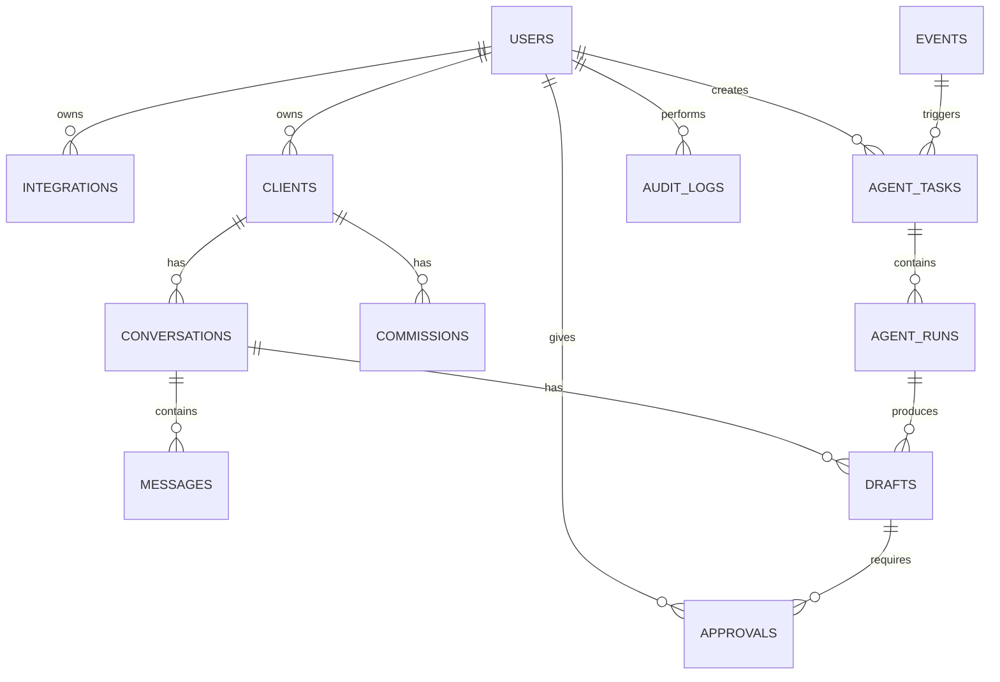

# ClientAgent — Data Model

> **Date:** 2026-10-16

---

## Overview

All tables use `bigint` primary keys and include `created_at` /
`updated_at` timestamps. JSON columns store flexible metadata that
doesn't warrant its own columns yet.

---

## Entity Relationship Diagram

---

## Tables

### users

Single-user system, but the table exists for foreign key integrity and
future flexibility.

| Column | Type | Notes |
|--------|------|-------|
| id | bigint | PK |
| name | text | |
| email | text | UNIQUE |
| created_at | timestamp | |
| updated_at | timestamp | |

---

### integrations

Tracks connected services (Gmail, Discord, Telegram).

| Column | Type | Notes |
|--------|------|-------|
| id | bigint | PK |
| user_id | bigint | FK → users |
| provider | text | gmail, discord, telegram |
| status | text | connected, disconnected, error |
| credentials_encrypted | text | Encrypted OAuth tokens etc. |
| metadata | jsonb | Provider-specific data |
| created_at | timestamp | |
| updated_at | timestamp | |

---

### clients

People the creator communicates with on external platforms.

| Column | Type | Notes |
|--------|------|-------|
| id | bigint | PK |
| user_id | bigint | FK → users |
| platform | text | vgen |
| external_id | text | Platform-specific ID if available |
| username | text | |
| display_name | text | |
| profile_url | text | |
| avatar_url | text | |
| metadata | jsonb | |
| first_seen_at | timestamp | |
| last_seen_at | timestamp | |
| created_at | timestamp | |
| updated_at | timestamp | |

**Unique constraint:** `(user_id, platform, username)`

---

### conversations

A thread of messages between the creator and a client.

| Column | Type | Notes |
|--------|------|-------|
| id | bigint | PK |
| client_id | bigint | FK → clients |
| platform | text | vgen |
| external_id | text | Platform conversation ID |
| external_url | text | |
| status | text | active, archived |
| last_synced_at | timestamp | |
| created_at | timestamp | |
| updated_at | timestamp | |

**Unique constraint:** `(platform, external_id)`

---

### messages

Individual messages within a conversation.

| Column | Type | Notes |
|--------|------|-------|
| id | bigint | PK |
| conversation_id | bigint | FK → conversations |
| external_id | text | Platform message ID |
| direction | text | inbound, outbound |
| sender_type | text | client, creator, agent |
| sender_name | text | |
| content | text | |
| metadata | jsonb | |
| sent_at | timestamp | |
| created_at | timestamp | |
| updated_at | timestamp | |

**Unique constraint:** `(conversation_id, external_id)`

---

### commissions

Work requests from clients.

| Column | Type | Notes |
|--------|------|-------|
| id | bigint | PK |
| client_id | bigint | FK → clients |
| external_id | text | |
| service_name | text | |
| amount | decimal | |
| currency | text | |
| estimated_start | date | |
| guaranteed_delivery | date | |
| status | text | See statuses below |
| metadata | jsonb | |
| created_at | timestamp | |
| updated_at | timestamp | |

**Commission statuses:**
`requested` → `accepted` → `paid` → `in_progress` → `delivered` →
`completed` | `cancelled`

---

### events

Raw events from external sources. The idempotency anchor.

| Column | Type | Notes |
|--------|------|-------|
| id | bigint | PK |
| source | text | gmail |
| provider | text | vgen |
| event_type | text | new_message, new_commission, etc. |
| external_id | text | UNIQUE — Gmail message ID |
| payload | jsonb | Raw event data |
| status | text | received, processed, failed |
| received_at | timestamp | |
| processed_at | timestamp | |
| created_at | timestamp | |
| updated_at | timestamp | |

The `external_id` uniqueness constraint is the primary deduplication
mechanism. If the same Gmail notification arrives twice, the second
insert fails and no duplicate work is created.

---

### agent_tasks

Units of work to be executed by workers.

| Column | Type | Notes |
|--------|------|-------|
| id | bigint | PK |
| user_id | bigint | FK → users |
| event_id | bigint | FK → events (nullable) |
| type | text | Task type enum |
| status | text | queued, running, completed, failed, dead |
| input | jsonb | |
| output | jsonb | |
| attempts | integer | Default 0 |
| max_attempts | integer | Default 5 |
| idempotency_key | text | |
| error | text | |
| started_at | timestamp | |
| completed_at | timestamp | |
| created_at | timestamp | |
| updated_at | timestamp | |

**Task types:**
`PROCESS_GMAIL_EVENT`, `NOTIFY_DISCORD`, `READ_VGEN_CONVERSATION`,
`SYNC_CONVERSATION`, `GENERATE_SUMMARY`, `GENERATE_REPLY_DRAFT`,
`SEND_VGEN_MESSAGE`, `SYNC_COMMISSION`

**Task statuses:**
`queued` → `running` → `completed` | `failed` → `dead`

---

### agent_runs

Individual AI execution records within a task.

| Column | Type | Notes |
|--------|------|-------|
| id | bigint | PK |
| task_id | bigint | FK → agent_tasks |
| provider | text | openai, anthropic, etc. |
| model | text | |
| system_version | text | Prompt version identifier |
| input | jsonb | |
| output | jsonb | |
| token_usage | integer | |
| duration_ms | integer | |
| status | text | |
| created_at | timestamp | |
| updated_at | timestamp | |

---

### drafts

AI-generated or manually created response drafts.

| Column | Type | Notes |
|--------|------|-------|
| id | bigint | PK |
| conversation_id | bigint | FK → conversations |
| agent_run_id | bigint | FK → agent_runs (nullable) |
| content | text | |
| status | text | See statuses below |
| approved_by | bigint | FK → users (nullable) |
| approved_at | timestamp | |
| sent_at | timestamp | |
| created_at | timestamp | |
| updated_at | timestamp | |

**Draft statuses:**
`draft` → `pending_approval` → `approved` → `sent`
                             → `rejected`
                             → `expired`
                             → `failed`

---

### approvals

Explicit approval/rejection records for drafts.

| Column | Type | Notes |
|--------|------|-------|
| id | bigint | PK |
| draft_id | bigint | FK → drafts |
| user_id | bigint | FK → users |
| action | text | approve, reject |
| status | text | |
| created_at | timestamp | |
| updated_at | timestamp | |

---

### audit_logs

Immutable record of significant actions.

| Column | Type | Notes |
|--------|------|-------|
| id | bigint | PK |
| user_id | bigint | FK → users (nullable for agent actions) |
| actor_type | text | user, agent, system |
| actor_id | bigint | |
| action | text | See actions below |
| target_type | text | draft, message, conversation, etc. |
| target_id | bigint | |
| metadata | jsonb | |
| ip_address | text | |
| created_at | timestamp | Immutable, no updated_at |

**Audit actions:**
`USER_APPROVED_DRAFT`, `USER_REJECTED_DRAFT`, `USER_EDITED_DRAFT`,
`AGENT_READ_CONVERSATION`, `AGENT_GENERATED_DRAFT`,
`AGENT_ATTEMPTED_SEND`, `MESSAGE_SENT`, `MESSAGE_SEND_FAILED`,
`USER_LOGIN`, `USER_LOGOUT`, `SESSION_EXPIRED`,
`INTEGRATION_CONNECTED`, `INTEGRATION_DISCONNECTED`

---

## Idempotency Strategy

### Events

The `events.external_id` UNIQUE constraint prevents duplicate event
records. The external ID is the Gmail message ID, which is globally
unique per message.

### Tasks

The `agent_tasks.idempotency_key` allows the system to check whether
a specific logical operation has already been created. Before creating
a task, check if one with the same idempotency key already exists.

### Messages

The `messages.(conversation_id, external_id)` constraint prevents
storing the same message twice when re-syncing a conversation.

---

## Notes

- All `jsonb` columns default to `{}` or are nullable, depending on
  whether the data is always expected.
- `bigint` IDs are used throughout. The builder may choose between
  auto-increment and generated IDs (nanoid, cuid, etc.).
- Timestamps are `timestamp with time zone` in PostgreSQL.
- Soft deletes are not used initially. If needed later, add a
  `deleted_at` column.
